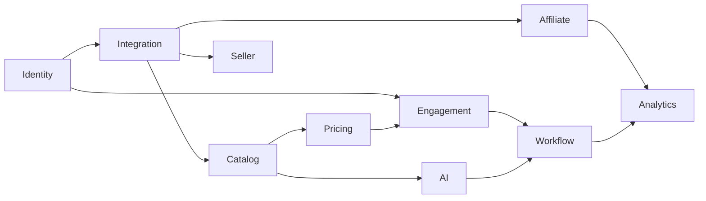

# 03 · DDD context map

Trạng thái PROPOSED. Mỗi module sở hữu bảng và transaction của mình; module khác gọi contract, không ghi trực tiếp bảng.

| Context / aggregate roots | Bảng sở hữu | Command / query / event | Lỗi và quyền |
|---|---|---|---|
| Identity: Tenant, Membership, Entitlement | tenants, users, memberships, roles, entitlements | JoinWorkspace / GetAccess / MembershipChanged | Không membership → deny; chỉ admin quản trị |
| Integration: ConnectorAccount, CapabilityPolicy | providers, connector_accounts, connector_scopes, source_capabilities, source_policy_versions, sync_jobs | GrantConsent / GetCapability / ConsentRevoked | Scope hết hạn → disabled; tenant admin |
| Catalog: SourceListing, SourceSku, ProductMatch | source_shops, source_listings, source_skus, canonical_products, product_matches, product_media | ResolveListing / GetSku / ListingResolved | Không match theo title; provenance access |
| Pricing: Observation, Baseline | price_observations, offer_observations, voucher_observations, price_baselines, deal_scores | RecordPrice / GetHistory / PriceObserved, DealScored | Currency/context mismatch → reject; authorized worker |
| Engagement: Watchlist, Rule | watchlists, watchlist_rules, alerts | TrackSku / GetTracking / TrackingEnabled, AlertQualified | Exact SKU và consent; tenant member |
| Affiliate: AffiliateLink, ReconciliationRun | affiliate_links, outbound_clicks, conversions, commission_events, reconciliation_runs | CreateLink / GetCommission / OutboundClicked, CommissionReconciled | Allowlist, không suy conversion; riêng tenant |
| AI (later): Brief, Draft, Approval | content_briefs, content_drafts, approvals | DraftContent / GetDraft / DraftApproved | Thiếu nguồn hoặc approval → block; editor |
| Workflow: Delivery, WorkflowRun | notification_deliveries, workflows, workflow_runs | DeliverAlert / GetDelivery / AlertDelivered | Opt-out, retry exhausted; worker scoped |
| Seller (later): SellerAccount, Campaign | creator_profiles, seller_accounts, affiliate_campaigns, collaboration_records | ImportMetric / GetCampaign / MetricImported | Scope/financial inputs thiếu → unavailable |
| Analytics: AuditEntry | audit_logs, quality summaries | AppendAudit / GetAudit / QualityFlagged | Append-only, admin/auditor; không chứa secret |

Module API là internal typed interfaces; public boundary REST/OpenAPI DTO, không expose EF entities. Event envelope gồm eventId, schemaVersion, tenantId (hoặc explicit public scope), occurredAt, correlationId, payload reference. Version schema additive trước, consumer phải idempotent.

Catalog có thể public theo policy; integration credentials và commission luôn private. Shared listing không cho phép suy ra tenant nào theo dõi. MVP tenant-private fixtures đơn giản hóa access; public projection là thay đổi sau. Outbox được ghi cùng transaction của module phát event; consumer sở hữu transaction riêng và inbox uniqueness.
