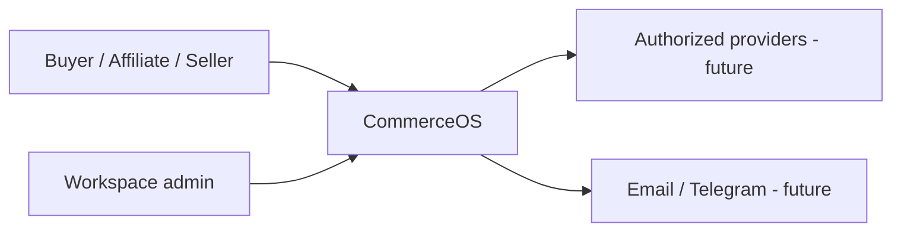
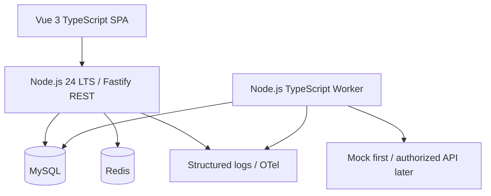
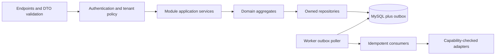

# 04 · C4 architecture

Trạng thái PROPOSED. Modular monolith giúp ít deploy unit, transaction đơn giản; worker cô lập retry. Chi phí là phải giữ module boundaries bằng code review/architecture checks.

## System context

## Containers

## API components

Vue/Vite theo preference, Nuxt chỉ khi đo được nhu cầu SSR. Backend Node.js 24 LTS + TypeScript/Fastify theo lựa chọn chủ repo. MySQL 8.4 giữ durable jobs/outbox; Redis phục vụ API rate limiter. Worker loop claim jobs có lease; scheduler định kỳ là bước sau, tránh thêm broker.

Local Compose dự kiến: web, api, worker, mysql, redis; health/readiness checks, migration job chạy rõ ràng trước app, volume database, environment mẫu không chứa secrets. Compose và health checks đã được triển khai trong slice mock; xem tài liệu 11 và README để chạy.

Alternative microservices tăng chi phí deploy và distributed transactions; migration path là tách worker/module bằng contracts và outbox khi có số đo. Kafka/ClickHouse không nằm trong baseline. Reverse proxy và TLS bắt buộc khi public deploy; production chưa được cấu hình.

## Cập nhật implementation 2026-11-16
Backend API/worker dùng Node.js 24 LTS + TypeScript/Fastify theo lựa chọn chủ repo. Vue dùng Pinia cho session và TanStack Query cho server state. MySQL là durable queue; Redis chỉ dùng API rate limiter. Nginx phục vụ static SPA/proxy API trong Compose. Không thêm runtime backend thứ hai.
