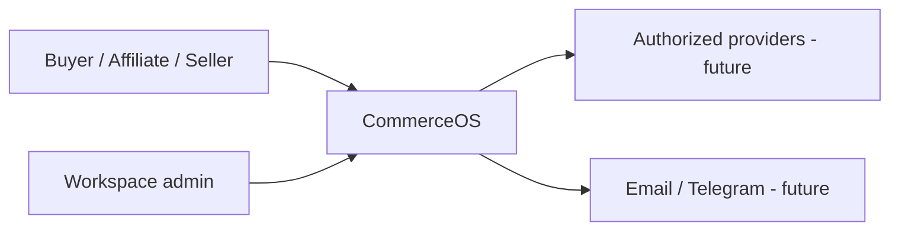
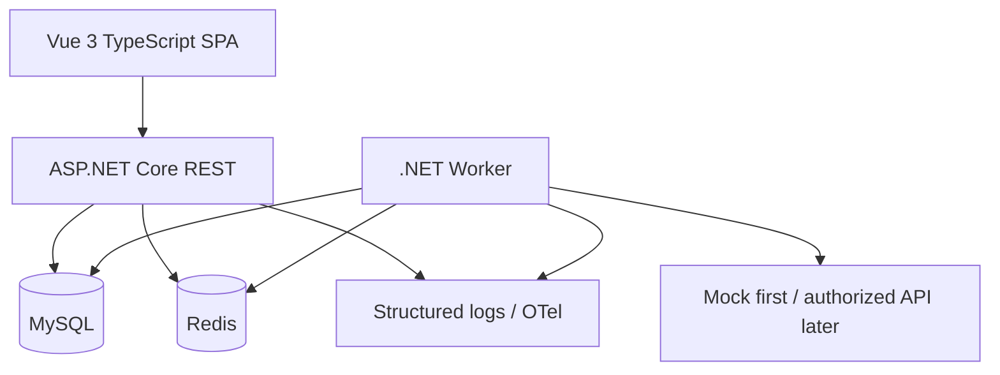
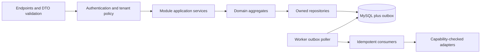

# 04 · C4 architecture

Trạng thái PROPOSED. Modular monolith giúp ít deploy unit, transaction đơn giản; worker cô lập retry. Chi phí là phải giữ module boundaries bằng code review/architecture checks.

## System context

## Containers

## API components

Vue/Vite theo preference, Nuxt chỉ khi đo được nhu cầu SSR. ASP.NET Core LTS: đề xuất .NET 10, cần xác minh support/runtime khi coding. MySQL 8.4 LTS đề xuất, Redis chỉ cache/short-lived coordination; durable work trong MySQL. Quartz cho schedule khi cần, tránh thêm broker.

Local Compose dự kiến: web, api, worker, mysql, redis; health/readiness checks, migration job chạy rõ ràng trước app, volume database, environment mẫu không chứa secrets. Đây là thiết kế, chưa có Compose chạy được.

Alternative microservices tăng chi phí deploy và distributed transactions; migration path là tách worker/module bằng contracts và outbox khi có số đo. Kafka/ClickHouse không nằm trong baseline. Reverse proxy và TLS bắt buộc khi public deploy; production chưa được cấu hình.
