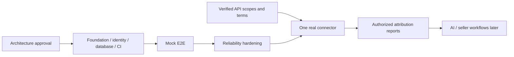
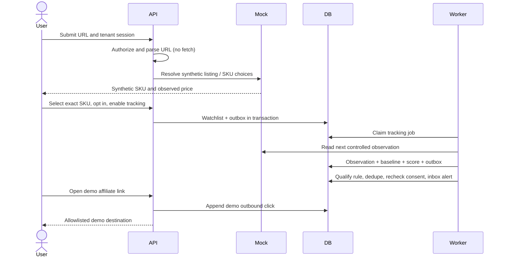

# 08 · MVP slices và execution workflow

PROPOSED; chưa có slice implementation nào được duyệt hoặc hoàn thành. Complexity S/M/L là tương đối, không là cam kết thời gian.

## Dependency graph

## Luồng nghiệp vụ

## Slice 1 đề xuất: synthetic E2E
Foundation: Vue SPA, .NET API/worker, MySQL migrations, Redis health/cache nếu thực sự dùng; Compose, local seed, CI. API/worker tenant-aware; session/login đủ kiểm chứng hai tenant. Adapter không gọi internet.

| ID | Work item / acceptance | Size | Depends |
|---|---|---|---|
| F1 | Scaffold + pinned tool versions + Compose; health checks và fresh DB migration chạy được | M | P0 |
| F2 | Membership/session + tenant policies; negative cross-tenant read/write tests | M | F1 |
| S1 | Submit URL, parse allowlist, show fixture SKU selection; invalid URL rejected | S | F2 |
| S2 | Persist selected SKU/watch rule and consent; explicit synthetic provenance | M | S1 |
| S3 | Worker job + transactional outbox/inbox + unique observation key; duplicate replay stable | L | S2 |
| S4 | Same-context baseline/score, freshness và unavailable states; controlled sample below threshold | M | S3 |
| S5 | Opt-in inbox delivery, dedupe và opt-out check trước gửi; no real email/Telegram | M | S4 |
| S6 | Demo affiliate mapping + allowlisted redirect + outbound click; no conversion inference | S | S2 |
| V1 | E2E, isolation/SSRF/429/retry tests, README run/reset, UI screenshots | M | S5,S6 |
| R1 | Dead-letter UI/ops replay, revoke simulation, restore drill | M | V1 |
| C1 | Một provider được phép với contract tests và capability evidence | L | R1, API authorization |

## Score đề xuất để review
Exact SKU/context và fresh observations là prerequisite. Baseline median prior eligible observations trong window cấu hình, loại current observation. `changePct = (baseline-current)/baseline*100`; score clamp 0..100 theo rule được hiển thị, confidence dựa sample count/age/match certainty. Không gọi phần trăm này là bằng chứng giảm giá thật. Không đủ mẫu hoặc baseline <= 0 → unavailable. Threshold, minSamples và window phải chốt khi duyệt slice; test dùng config explicit.

## Definition of Done
Clean checkout chạy theo README; migrate/seed repeatable; toàn bộ fixture gắn synthetic. E2E chứng minh URL → SKU → theo dõi → observation mới → explainable score → đúng một inbox alert cho cùng price state → một demo click. Reject invalid URL; không HTTP fetch URL người dùng. Hai tenant không truy cập chéo. Stale/mismatch không cảnh báo; opt-out trước send có hiệu lực. Retry duplicate không thêm observation/alert; 429 và exhausted retries có trạng thái thấy được. CI chạy checks thật và báo lỗi thật; report command/results, không dùng placeholder pass. UI change có screenshot lúc triển khai.

## Architecture-to-implementation gate
Chủ repo xác nhận domain boundaries, mock scope, tiêu chí thành công, price wording và freshness/test defaults. API thật là gate riêng yêu cầu quyền và terms được xác minh. Setup tài liệu không có nghĩa các gate đã được thông qua.
